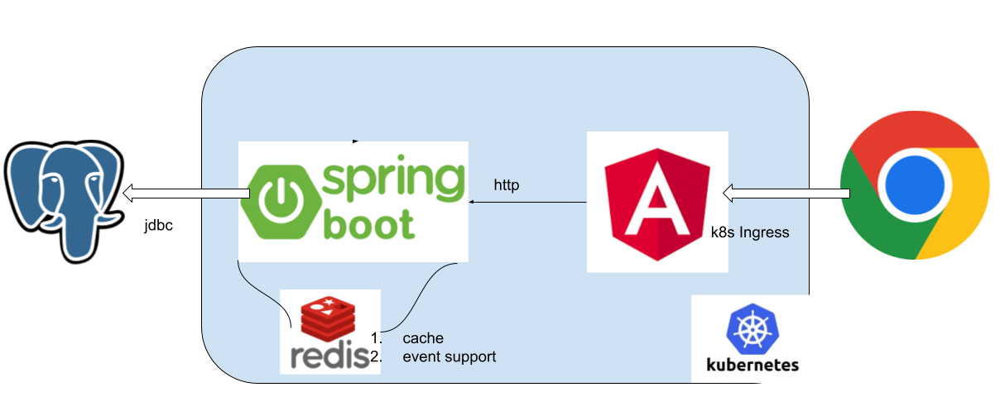
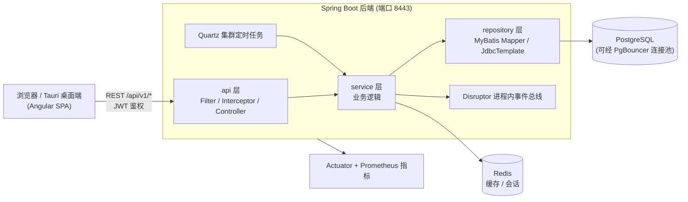

# Hoteler

[](https://github.com/damingerdai/hoteler/actions/workflows/ci.yml)
[](./LICENSE)
[](https://openjdk.org/)
[](https://spring.io/projects/spring-boot)
[](https://angular.dev/)

一个入门级但功能完整的**酒店管理系统**：后端基于 Spring Boot（Java 21），前端基于 Angular（[hoteler-web](https://github.com/damingerdai/hoteler-web)），覆盖酒店日常运营的核心流程。无论你是想学习全栈开发、寻找 Spring Boot 实战参考，还是想参与开源贡献，这个项目都欢迎你。

**系统功能**：登录验证（JWT + 角色权限）、房态统计、预定登记、入住登记、换房登记、客人信息查询、退房结算，所有操作均持久化入库。

| 登录 | 仪表盘 | 暗黑模式 |
| --- | --- | --- |
|  |  |  |

## 目录

- [项目组成](#项目组成)
- [架构概述](#架构概述)
- [快速开始](#快速开始)
- [测试与代码质量](#测试与代码质量)
- [贡献指南](#贡献指南)
- [部署](#部署)
- [许可证与鸣谢](#许可证与鸣谢)

## 项目组成

Hoteler 由两个仓库协作构成，前端以 git submodule 的形式挂载在本仓库中：

| 仓库 / 模块 | 说明 | 技术栈 |
| --- | --- | --- |
| [hoteler](https://github.com/damingerdai/hoteler)（本仓库） | 后端服务：REST/GraphQL API、业务逻辑、安全鉴权、定时任务 | Java 25、Spring Boot 4、MyBatis、PostgreSQL、Redis |
| [hoteler-web](https://github.com/damingerdai/hoteler-web) | 前端管理台，submodule 位于 `src/main/angular` | Angular 22、Angular Material、Tailwind CSS、TypeScript、Tauri（桌面端） |
| `migration/`（本仓库内） | 独立的数据库迁移命令行工具 | Go、golang-migrate、cobra |

- 在线演示：<https://vercel-hoteler.damingerdai.com/>
- 前端的环境要求、页面结构、桌面端打包等细节请参阅 [hoteler-web 的 README](https://github.com/damingerdai/hoteler-web#readme)。

## 架构概述

### 总体架构



一次典型请求的流转如下：



### 技术栈

| 领域 | 选型 |
| --- | --- |
| 语言 / 运行时 | Java 21（启用虚拟线程），构建工具 Gradle（同时保留 Maven，CI 双轨验证） |
| Web / API | Spring MVC（REST，前缀 `/api/v1`）、Spring GraphQL（开发中）、springdoc-openapi（Swagger UI） |
| 安全 | Spring Security + JWT（jjwt），RBAC 角色/权限模型，登录失败次数限制，多种口令加密策略（noop/md5/…） |
| 数据访问 | MyBatis + Spring JDBC，PostgreSQL 17，PgBouncer 连接池（Docker 部署时） |
| 缓存 | Redis + Caffeine 本地缓存 |
| 异步 / 调度 | Disruptor 进程内消息队列，Quartz（JDBC 存储、集群模式） |
| 数据库迁移 | Flyway SQL 脚本 + 独立 Go 迁移工具（见下文） |
| 可观测性 | Spring Actuator、Micrometer + Prometheus、Logback |
| 前端 | Angular 22 + Angular Material + Tailwind CSS，Vitest 单测、Cypress E2E，Tauri 桌面打包 |

### 后端目录结构

代码位于 `src/main/java/org/daming/hoteler`，按职责分层：

| 包 | 职责 |
| --- | --- |
| `api/web` | REST 控制器：用户、角色、房间、房间分组、客人、订单、统计、定时任务、Token 等 |
| `api/graphql` | GraphQL 接口（尚未完成） |
| `api/filter` / `api/interceptor` / `api/advice` | 请求过滤、拦截与统一异常处理 |
| `service` | 业务逻辑层（含 `service/stat` 统计服务） |
| `repository` | 数据访问层：`mapper`（MyBatis）与 `jdbc`（JdbcTemplate 实现） |
| `security` | 认证 Provider、JWT、口令加密策略 |
| `config` | Spring 配置、配置属性与动态配置服务 |
| `pojo` | DTO / VO / 枚举 / 请求响应对象 / 转换器 |
| `task` / `mq` | Quartz 定时任务、Disruptor 事件处理 |
| `base` / `utils` / `constants` / `listener` | 上下文、异常、日志等基础设施与工具 |

资源目录 `src/main/resources`：`application.yml`（运行配置）、`db/migration`（Flyway SQL）、`graphql`（Schema）、`lua`（Redis 脚本）、`errors.yml`（错误码）。

### 前端结构（hoteler-web）

- `src/app/routes` — 仪表盘、房间、客人、用户、订单、设置等业务页面
- `src/app/core` — 共享服务、API 封装、路由守卫
- `src/app/layout` — 应用外壳与导航
- `src-tauri` — 桌面端打包
- 前后端通过 `/api/v1/...` 交互；本地开发用 `src/proxy.conf.js` 代理到后端（`BACKEND_URL` 环境变量可覆盖，默认 `http://localhost:8443`）

### 接口入口

| 入口 | 地址（本地默认） |
| --- | --- |
| REST API | `http://localhost:8443/api/v1/...` |
| Swagger UI | <http://localhost:8443/swagger-ui/index.html?url=/v3/api-docs> |
| GraphiQL（开发中） | <http://localhost:8443/graphiql?path=/graphql> |
| 健康检查 / 指标 | `http://localhost:8443/actuator/health`、`/actuator/prometheus` |

### 数据库与迁移

仓库中并存两套迁移体系，**二选一**即可：

1. **Go 迁移工具（推荐，CI 使用的方式）**：位于 `migration/`，基于 golang-migrate，脚本在 `migration/db/migrations`（含 up/down），演示数据在 `migration/db/seeds`。用法详见 [migration/README.md](./migration/README.md)。
2. **Flyway**：SQL 脚本在 `src/main/resources/db/migration`，文件名格式 `V<时间戳>__<描述>.sql`，内置 admin 种子账号。运行时 Flyway 自动迁移是关闭的（`spring.flyway.enabled: false`），需手动执行：
   - Maven：`./mvnw flyway:migrate`
   - Gradle：`./gradlew flywayMigrate`（注意：当前 Gradle 插件配置了 `skipExecutingMigrations`，只记录历史不执行 SQL，初始化请用上面两种方式）

> 修改表结构时，请**同步更新两套迁移脚本**，保持 schema 一致。

## 快速开始

### 环境要求

| 依赖 | 版本 | 用途 |
| --- | --- | --- |
| JDK | 21+（CI 使用 25） | 后端编译运行 |
| Go | 1.27+ | 数据库迁移工具（可选，也可用 Maven Flyway） |
| Node.js + npm | 24+（前端 `.nvmrc` 指定 26.x） | 前端开发 |
| Docker + Docker Compose | 较新版本 | 一键启动 PostgreSQL / Redis |

本地开发需要 PostgreSQL（`5432`）与 Redis（`6379`）。凭据通过环境变量/配置文件注入，**不要提交任何真实密钥**。

### 1. 克隆仓库（含前端 submodule）

```shell
git clone git@github.com:damingerdai/hoteler.git --recurse-submodules --remote-submodules
# 或使用 HTTPS：
# git clone https://github.com/damingerdai/hoteler.git --recurse-submodules --remote-submodules
```

### 2. 启动数据库与 Redis

```shell
# 首次使用需创建外部数据卷与网络（docker-compose.yml 中声明为 external）
docker volume create --name=hoteler-volume
docker volume create --name=hoteler-redis-volume
docker network create hoteler-network

docker compose up -d db redis
```

默认创建 `postgres` 库，账号 `postgres/123456`。

### 3. 初始化数据库

方式 A：Go 迁移工具（推荐）

```shell
cd migration
cp example.env .env   # 将 POSTGRES_DB 改为 postgres，与上一步保持一致
make build
./hoteler migrate up  # 建表
./hoteler seed        # 写入演示用户与角色
cd ..
```

方式 B：Maven Flyway 插件（内置 admin 种子账号）

```shell
./mvnw flyway:migrate
```

### 4. 启动后端

```shell
./gradlew bootRun
```

> **注意**：`application.yml` 默认连接 `hoteler` 库，而 Docker Compose 创建的是 `postgres` 库。使用 Compose 默认配置时，请覆盖数据源地址：
>
> ```shell
> SPRING_DATASOURCE_URL=jdbc:postgresql://127.0.0.1:5432/postgres ./gradlew bootRun
> ```
>
> 或者自行创建 `hoteler` 库并把迁移执行到该库。

### 5. 启动前端（二选一）

**前后端分离开发**（热更新，推荐日常开发）：

```shell
cd src/main/angular
npm install
npm start   # ng serve，默认 http://localhost:4200，/api 自动代理到 8443
```

**一体化构建**（前端产物打进后端 jar，单进程运行）：

```shell
sh scripts/build.sh   # 构建 Angular 并拷贝到 resources/static，再 gradle build -Pstandalone
```

### 访问系统

- 应用入口：<http://localhost:8443>（一体化构建）或 <http://localhost:4200>（分离开发）
- 默认账号：`admin / 12345`（Flyway 种子）；若使用 Go 工具 seed，则为 `daming / 12345` 或 `xiao2 / 12345`
- Swagger UI 与 GraphiQL 入口见[接口入口](#接口入口)

## 测试与代码质量

```shell
# 后端单测（JUnit Platform，需要本地 PostgreSQL + Redis 及已迁移的库）
./gradlew test

# Checkstyle（默认关闭，需显式开启）
./gradlew checkstyleMain checkstyleTest -PenableCheckstyle=true

# Go 迁移工具测试
cd migration && go test ./...

# 前端测试与 Lint（在 src/main/angular 下）
npm test
npm run lint
```

CI（`.github/workflows/ci.yml`）在每次 push / PR 时：启动 PostgreSQL 与 Redis 服务容器 → 用 Go 工具执行迁移 → 以 **Gradle 和 Maven 双矩阵**（JDK 25）运行完整测试。提交 PR 前请在本地跑通相关测试。

## 贡献指南

欢迎任何形式的贡献：修复 Bug、实现新功能、完善文档、补充测试、改进部署脚本。

### 贡献流程

1. **找事做**：浏览 [Issues](https://github.com/damingerdai/hoteler/issues)（前端问题在 [hoteler-web Issues](https://github.com/damingerdai/hoteler-web/issues)），或先开 Issue 讨论你的想法，避免重复劳动。
2. **Fork + 分支**：Fork 本仓库，从 `master` 拉出特性分支，如 `feat/room-group-export`、`fix/login-lockout`。
3. **编码 + 测试**：遵循下方代码规范，为新行为补充测试；本地跑通聚焦测试后再跑全量 `./gradlew test`。
4. **提交**：使用 Conventional Commit 风格，如 `feat(room): ...`、`fix(deps): ...`、`chore: ...`、`ci: ...`，可关联 Issue/PR 编号。
5. **发起 PR**：目标分支 `master`，按 [PR 模板](./.github/pull_request_template.md)填写 Summary 与 Changelog，并勾选清单：
   - 是否为新增代码编写了测试？没有的话说明原因；
   - 是否引入新依赖？有的话列出依赖与理由。
6. **等待 CI 与 Review**：CI 全绿后维护者会进行评审；根据反馈迭代即可。

### 代码规范

- **Java**：4 空格缩进、常规大括号风格，遵循 `config/checkstyle.xml`；包名小写，类/接口 `PascalCase`（接口沿用项目的 `I...` 前缀），方法/字段 `camelCase`。
- **SQL 迁移**：Flyway 脚本保持 `V<时间戳>__<描述>.sql` 命名；Go 工具用 `./hoteler migrate create <name>` 生成成对的 up/down 脚本；两套脚本需同步修改。
- **Go**：提交前执行 `gofmt`（或 `cd migration && make fmt`）。
- **前端**：遵循 hoteler-web 仓库的 ESLint / Stylelint / Prettier 配置，提交信息同样使用 Conventional Commits（该仓库有 commitlint 校验）。

### PR 注意事项

- 涉及**迁移、配置、部署**的改动请在 PR 描述中显著说明。
- UI 改动请附截图（前端 PR 提交到 [hoteler-web](https://github.com/damingerdai/hoteler-web)）。
- 不要提交密钥、`.env` 真实凭据或本地数据；依赖变更需披露。
- 保持改动聚焦，一个 PR 解决一件事。

## 部署

### Docker

仓库提供 `Dockerfile` / `full.Dockerfile` / `maven.Dockerfile` 多种镜像构建方式。全栈启动（后端 + PostgreSQL + PgBouncer + Redis）：

```shell
docker compose up -d
```

后端容器通过挂载 `application-docker.yml` 覆盖配置，环境变量写入根目录 `.env`（勿提交）。

### Kubernetes

部署清单在 `deplyoments/` 目录（含 `app.yaml`、`db.yaml`、`redis.yaml`、Helm Chart 与 k3s 配置）。示例：

```shell
kubectl apply -f deplyoments/db.yaml
kubectl apply -f deplyoments/app.yaml
kubectl port-forward --namespace hoteler-namespace service/postgres 5432:5432
kubectl port-forward --namespace hoteler-namespace service/hoteler-web 4200:80
```

> ⚠️ 如需重置环境，可先执行 `kubectl delete namespace hoteler-namespace` 及对应 PVC/PV 清理，**该操作会删除全部数据**，请谨慎。

## 许可证与鸣谢

本项目基于 [MIT License](./LICENSE) 开源。

感谢 [JetBrains](https://jb.gg/OpenSourceSupport) 对开源项目的支持：

[](https://jb.gg/OpenSourceSupport)
